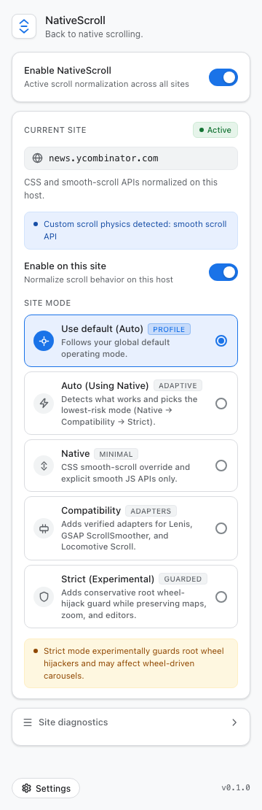
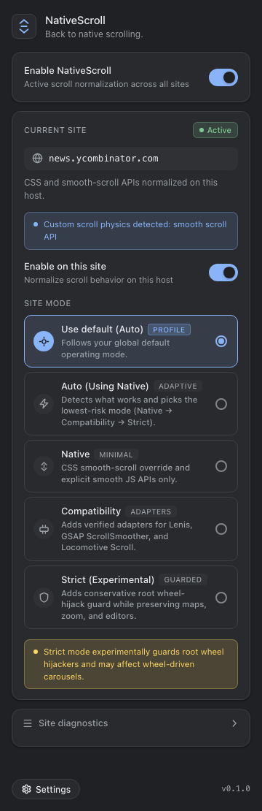
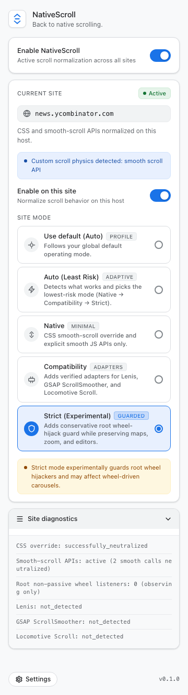
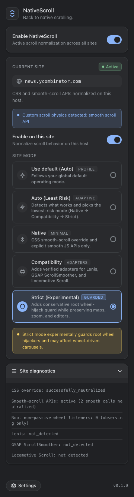
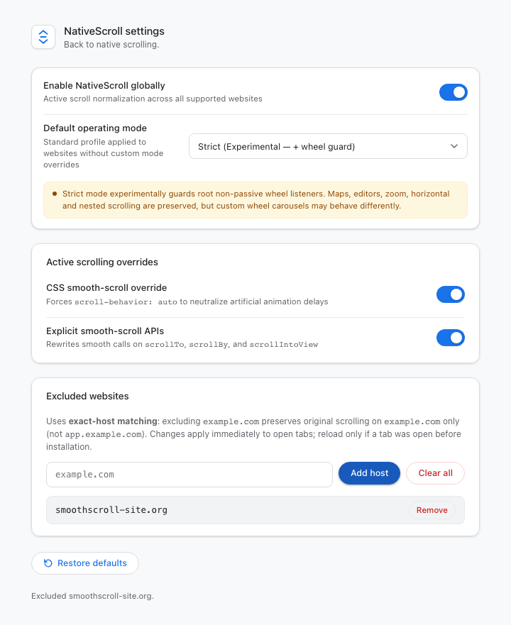
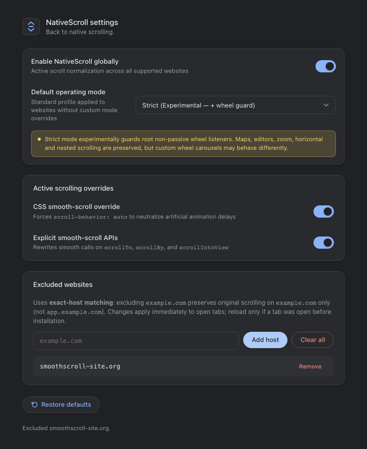

# NativeScroll

**Back to native scrolling.**

NativeScroll is a lightweight Chrome Manifest V3 extension that neutralizes artificial website smooth-scrolling physics and restores browser-native scrolling.

## Scope & Non-Goals

- **What NativeScroll does:** Removes CSS `scroll-behavior: smooth`, rewrites explicit smooth JavaScript scroll API calls (`window.scrollTo/scrollBy`, `Element.scrollTo/scrollBy/scrollIntoView`) to immediate native scrolling, optionally neutralizes supported scrolling libraries (`Lenis`, `GSAP ScrollSmoother`, `Locomotive Scroll v5`), and provides an opt-in experimental wheel guard for root scroll hijackers.
- **What NativeScroll is NOT:** It is **not** a scroll-speed accelerator, does **not** inject custom inertia/easing, and does **not** claim universal mouse-wheel vs. trackpad hardware detection.

## Operating Modes

| Mode | Behavior | Recommended For |
|---|---|---|
| **Native (Default)** | CSS `scroll-behavior: auto !important` + explicit smooth JS scroll API normalization only | Everyday browsing; preserves all nested scroll, horizontal gestures, maps, carousels, and editors |
| **Compatibility** | `Native` + verified library adapters (`Lenis 1.x`, `GSAP ScrollSmoother 3.x`, `Locomotive Scroll 5.x`) | Sites using third-party smooth-scroll engines |
| **Strict (Experimental)** | `Compatibility` + conservative root non-passive wheel listener guard (preserves `Ctrl+wheel`, horizontal deltas, nested scrollables, canvas/maps/editors) | Aggressive custom wheel hijackers; can be disabled immediately per site |

## Screenshots

Engineered to look and feel indistinguishable from Google Chrome native UI, adhering to Chromium WebUI tokens (`cr_elements`, `cr_shared_vars`) and Material Design 3 guidelines across light and dark themes.

### Toolbar Popup & Card-Based Site Modes

| Light Theme | Dark Theme |
|:---:|:---:|
|  |  |

### Site Diagnostics & Strict Wheel Guard

| Diagnostics Expanded (Light) | Strict Mode Alert & Traces (Dark) |
|:---:|:---:|
|  |  |

### Settings & Exclusions Surface

| Settings (Light) | Settings (Dark) |
|:---:|:---:|
|  |  |

## Quick Start (Bun)

Prerequisites: [Bun](https://bun.sh/docs/installation) and Google Chrome (or Chromium MV3 browser).

```sh
bun install
bun run typecheck
bun run lint
bun run test
bun run build
bun run test:e2e
```

Additional developer scripts:

```sh
bun run fixtures      # Serve local deterministic fixtures at http://127.0.0.1:4173/
bun run benchmark     # Run reproducible Chromium scroll-latency benchmarks
bun run profile       # Run CDP memory, CPU, startup & multi-tab profiler
```

## Load Unpacked in Chrome

1. Run `bun run build` (outputs to `dist/`).
2. Open `chrome://extensions` and enable **Developer mode**.
3. Click **Load unpacked** and select the `dist/` directory.

You can also download prebuilt `nativescroll-chrome-extension` artifacts from [GitHub Actions](https://github.com/harysuryanto/chrome-native-scroll/actions/workflows/verify.yml).

## Opt-Out, Exclusions & Troubleshooting

- **Exclude a website:** Click the NativeScroll toolbar icon and toggle **Enable on this site** off, or manage exact-host exclusions in **Settings**.
- **Already-open tabs:** Changes to exclusions and modes apply live to open tabs. Reload a tab only if it was opened before NativeScroll was installed.
- **Diagnostics:** Expand **Site diagnostics** in the popup to inspect real runtime state (`successfully_neutralized`, `not_detected`, `unsupported`, `failed`).
- **Known limitations:** Browser internal pages (`chrome://`, `about:`, Chrome Web Store) cannot be modified by extensions; legacy Locomotive Scroll v4 transform containers degrade safely to `unsupported`; synthetic `WheelEvent` tests do not emulate physical trackpad feel.

## Privacy & Permissions

NativeScroll requests only `storage` (local preferences in `chrome.storage.local`) and `activeTab` (reading the active tab URL when you open the popup). Zero telemetry, zero external network requests, zero UI frameworks. See [docs/security/audit.md](docs/security/audit.md).

## Documentation

- [Architecture Guide](docs/architecture.md)
- [Compatibility Matrix](docs/compatibility-matrix.md)
- [Wheel-Event Latency Research](docs/research/wheel-event-latency.md)
- [Benchmark Methodology & Results](docs/benchmarks/methodology.md)
- [Memory & CPU Performance Profile](docs/benchmarks/performance-profile.md)
- [Security & Privacy Audit](docs/security/audit.md)
- [Manual Hardware QA Checklist](docs/testing/manual-hardware-checklist.md)
